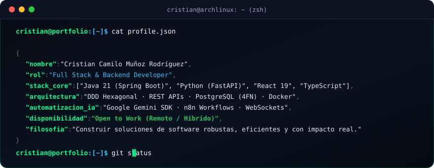

  <!-- BANNER SVG PRINCIPAL -->
  
    

  <!-- EFECTO TYPING ANIMADO -->
  
    

  <!-- BADGES DE CONTACTO SUPERIORES -->
  
  &nbsp;
  
  &nbsp;
  

---

### Sobre mí

  <!-- TERMINAL DE MAC SVG ESTILIZADA -->
  

 

- ⚡ **Backend & Arquitectura:** Desarrollo robusto con **Java 21 (Spring Boot)**, **Python 3.12 (FastAPI)**, Domain-Driven Design (DDD) y Arquitectura Hexagonal.
- 🎨 **Frontend Moderno:** Construcción de interfaces reactivas, tipadas y responsivas con **React 19**, **TypeScript** y **Tailwind CSS**.
- 🗄️ **Bases de Datos & Persistencia:** Modelado estricto en **PostgreSQL 16** (normalización hasta 4FN), **MySQL** y optimización de consultas ACID.
- 🤖 **IA & Automatización:** Integración determinista de LLMs (**Google Gemini SDK** con Structured Outputs), agentes inteligentes y flujos en **n8n**.
- 🐳 **Entornos & DevOps:** Despliegues y orquestación reproducible con **Docker & Docker Compose** en entornos **Linux**.

---

### Stack Tecnológico

  <!-- ICONOS DE SKILLS ACTUALIZADOS -->
  

 

<b>Desglose por áreas de especialidad</b>

 

| Área | Tecnologías & Herramientas |
| :--- | :--- |
| **Backend & Core** | `Java 21` `Spring Boot 3.4+` `Python 3.12` `FastAPI` `Node.js` `Spring Security 6 (JWT RBAC)` `REST APIs` |
| **Frontend & UI/UX** | `React 19` `TypeScript` `JavaScript (ES6+)` `Tailwind CSS` `Vite` `HTML5` `CSS3` `Responsive Design` |
| **Bases de Datos** | `PostgreSQL 16 (4FN)` `MySQL 8.0` `Modelado Relacional` `ACID Transactions` |
| **IA & Automatización** | `Google Gemini SDK (gemini-3.8-flash)` `n8n Workflows` `Agentes IA` `WebSockets (STOMP)` |
| **Herramientas & DevOps** | `Docker` `Docker Compose` `Linux / Bash` `Git` `GitHub` `Postman` `VS Code` `STS4` |

---

### Proyectos Destacados

<table>
  <tr>
    <td width="50%" valign="top">
      <h3 align="center">Renta_Tools</h3>
      

        <b>Marketplace B2B/B2C para Renta de Maquinaria y Equipos</b> 
        Plataforma empresarial para la gestión, reserva, inspección física y facturación electrónica de maquinaria pesada y herramientas de construcción.
      

      <ul>
        <li><b>Arquitectura:</b> DDD Hexagonal multi-módulo (domain, application, infrastructure).</li>
        <li><b>Seguridad:</b> Autenticación sin estado y RBAC (Admin, Proveedor, Cliente) con Spring Security 6 y JWT.</li>
        <li><b>Base de Datos:</b> PostgreSQL 16 modelado bajo estricta Cuarta Forma Normal (4FN).</li>
        <li><b>Módulos Clave:</b> Generación dinámica de facturas PDF (OpenPDF), eventos en tiempo real con WebSockets (STOMP) y geolocalización con Leaflet.js.</li>
        <li><b>Despliegue:</b> Orquestado 100% mediante Docker Compose.</li>
      </ul>
      

        <code>Java 21</code> • <code>Spring Boot 3.4+</code> • <code>PostgreSQL 16</code> • <code>Docker</code>
      

      

        <a href="https://github.com/Leonardo4516/Proyecto_RentaHerramientas"><b>Explorar Código en GitHub →</b></a>
      

    </td>
    <td width="50%" valign="top">
      <h3 align="center">Campuslands OpsCenter</h3>
      

        <b>Gestión Operativa de Campus Asistida por Inteligencia Artificial</b> 
        Sistema centralizado para control de aforos, reserva de espacios, trazabilidad de recursos tecnológicos y mitigación de contingencias en tiempo real.
      

      <ul>
        <li><b>Frontend:</b> Single Page Application (SPA) responsiva y tipada con React 19, TypeScript y Tailwind CSS.</li>
        <li><b>Triaje con IA:</b> Integración de Google Gemini API (gemini-3.8-flash) con Structured Outputs para clasificar severidad de fallas.</li>
        <li><b>Reglas de Negocio:</b> Bloqueo preventivo automático de salas (HTTP 423 Locked) y prevención algorítmica de solapamientos.</li>
        <li><b>Backend & APIs:</b> API REST asíncrona en FastAPI (Python 3.12), PostgreSQL 16 y generación de pases QR.</li>
        <li><b>Contenedores:</b> Entorno reproducible con Docker Compose.</li>
      </ul>
      

        <code>React 19</code> • <code>TypeScript</code> • <code>FastAPI</code> • <code>Gemini 3.8 Flash</code>
      

      

        <a href="https://github.com/Cristixn04/Campuslands-OpsCenter-"><b>Explorar Código en GitHub →</b></a>
      

    </td>
  </tr>
</table>

---

### Métricas de GitHub

  <!-- Mirror de alta disponibilidad con colores personalizados a juego con el banner -->
  
  

  

---

### Conéctate Conmigo

  
  &nbsp;
  
  &nbsp;
  
  &nbsp;
  

 

  

